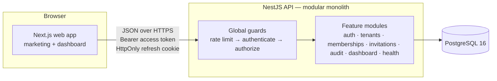
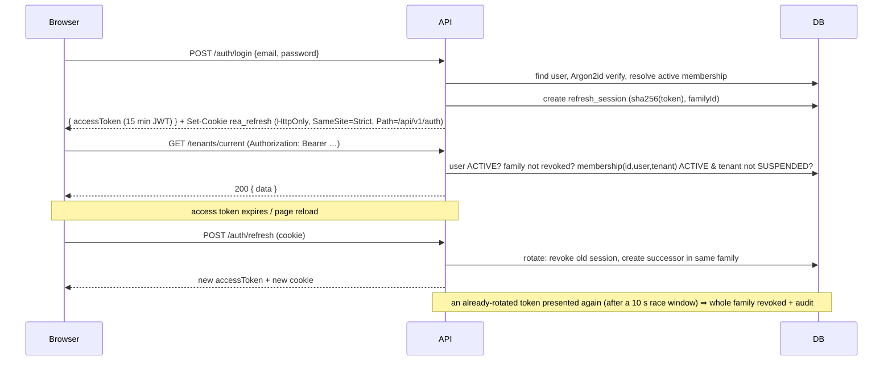

# Architecture

## Product context

AI Real Estate Sales Employee is a multi-tenant SaaS for Indian brokers, agencies, builders and developers. The long-term product has an AI employee that talks to buyers over chat, WhatsApp and phone in Hindi, English and Hinglish. **Phase 1 (this codebase) is the foundation:** accounts, tenants, memberships, role-based access, onboarding, team management, settings, audit logs and the dashboard shell. No AI, voice, WhatsApp, telephony, leads or properties exist yet.

## System overview



| Layer   | Technology                                                                                                                                       |
| ------- | ------------------------------------------------------------------------------------------------------------------------------------------------ |
| Web     | Next.js 15 (App Router), React 19, TypeScript, Tailwind CSS 4, Radix primitives (shadcn-style components), React Hook Form + Zod, TanStack Query |
| API     | NestJS 11, REST, Swagger/OpenAPI, class-validator DTOs                                                                                           |
| Data    | PostgreSQL 16, Prisma 7 (driver adapter `@prisma/adapter-pg`), UUID keys                                                                         |
| Auth    | JWT (HS256) access tokens, rotating opaque refresh tokens, Argon2id                                                                              |
| Tests   | Jest + Supertest (API), Playwright (browser)                                                                                                     |
| Tooling | pnpm workspaces, ESLint 9 flat config, Prettier, Docker Compose                                                                                  |

## Repository layout

```
real-estate-ai/
  apps/
    api/                    NestJS API
      src/
        common/             cross-cutting: errors, filters, pipes, guards, decorators, validation, utils
        config/             env schema (zod) + typed AppConfigService
        database/           PrismaService, seed script
        generated/prisma/   Prisma client (generated, git-ignored)
        modules/
          auth/             register, login, refresh, logout, me, switch-tenant; JwtAuthGuard
          tenants/          current tenant, business profile, settings, onboarding
          memberships/      tenant-context resolution, member listing, role/status changes
          invitations/      create/list/revoke, public preview/accept
          roles/            PermissionsGuard + @RequirePermissions()
          audit/            AuditService (write) + GET /audit-logs
          dashboard/        GET /dashboard/overview
          health/           liveness + readiness
      test/                 e2e tests (Supertest, real database)
    web/                    Next.js app
      src/app/              routes: (marketing), (auth)/login|register, accept-invitation, onboarding, dashboard/*
      src/components/       ui primitives, layout (sidebar/topbar), states (loading/empty/error)
      src/features/         auth, onboarding, dashboard, team, settings, ai-employee
      src/lib/              API client, query keys, navigation, utils
      e2e/                  Playwright tests
  packages/
    shared-types/           enums, API types, permission matrix — used by both apps
    eslint-config/          shared flat configs (base, nest, next)
    typescript-config/      shared tsconfig bases
  prisma/                   schema.prisma + migrations
  docs/                     this documentation
```

`users/` from the original plan is not a separate module: in Phase 1 users are only created by registration and invitation acceptance, so that logic lives in `auth` and `invitations`. A `users` module should be added when profile editing arrives.

## Request pipeline (API)

Every request passes through, in order:

1. **RequestIdMiddleware** — assigns/propagates `x-request-id`.
2. **helmet** security headers, **CORS** allow-list, **cookie-parser**.
3. **ThrottlerGuard** — global limit per IP; a stricter named limit applies to `@StrictRateLimit()` routes (login, register, invitation preview/accept).
4. **JwtAuthGuard** (global, deny-by-default) — skips only `@Public()` routes. Verifies the token, then re-reads the database (see _Tenant isolation_).
5. **PermissionsGuard** (global) — enforces `@RequirePermissions(...)` against the role read in step 4.
6. **ValidationPipe** — whitelists DTO fields, rejects unknown ones (`forbidNonWhitelisted`), transforms types.
7. Controller → service → Prisma.
8. **ResponseEnvelopeInterceptor** wraps results as `{ data }` / `{ data, meta }`; **AllExceptionsFilter** renders every error as `{ error: { code, message, details?, requestId } }` and never leaks stack traces.

Controllers are thin; business rules live in services; related writes use `prisma.$transaction`.

## Authentication flow



- **Access token**: HS256 JWT with `sub` (user), `fam` (session family), `tid`/`mid` (active tenant/membership). Issuer/audience/algorithm pinned. Kept **in memory** by the web app — never in localStorage.
- **Refresh token**: 256-bit random, only its SHA-256 is stored, rotated on every use, delivered in an `HttpOnly; SameSite=Strict; Path=/api/v1/auth` cookie (`Secure` in production). Refresh/logout also check `Origin` against the CORS allow-list.
- **Logout** revokes the whole family, so outstanding access tokens stop working immediately (the guard checks the family).
- **Multiple businesses**: `POST /auth/switch-tenant` moves the session to another tenant where the user has an active membership.

## Tenant isolation

Isolation is enforced by construction, not by convention:

1. **No tenant ID is ever accepted from the client.** Routes are `/tenants/current/...`; there are no `/tenants/:id` routes. Unknown body fields such as `tenantId` are rejected with 400.
2. **Tenant context comes from the database on every request.** The guard reloads the membership named in the token and requires that it belongs to the token's user, is `ACTIVE`, and that its tenant is not `SUSPENDED`. The role is taken from that row — so role changes and suspensions apply on the next request. A correctly signed token whose tenant claim points elsewhere is rejected (tested).
3. **Every tenant-owned query is keyed by `ctx.tenantId`.** Lookups by ID use `findFirst({ where: { id, tenantId } })`, so another tenant's IDs return 404 (IDOR-safe).
4. **Tests prove it** (`test/tenant-isolation.e2e-spec.ts`, `test/team.e2e-spec.ts`): Business A cannot read or modify Business B through query strings, headers, request bodies, forged tenant claims, foreign membership/invitation IDs or tenant switching.

### Row-Level Security (prepared, not enabled)

PostgreSQL RLS is a planned second layer. It is **not enabled** in Phase 1 because a correct implementation needs per-request `SET LOCAL app.tenant_id` inside a transaction for every query, which Prisma's connection pooling does not do automatically; a partial setup would either break queries or give false assurance. The schema is ready for it: every tenant-owned table has a `tenant_id` column and index. The recommended rollout is in `database-design.md`.

## Authorization model

Permissions are `resource:action` strings defined once in `@rea/shared-types` (`ROLE_PERMISSIONS`) and enforced by `PermissionsGuard`. The web app imports the same matrix only to hide controls a user cannot use — the API never trusts the UI.

| Permission                                  | Owner | Admin | Manager | Sales agent | Viewer |
| ------------------------------------------- | :---: | :---: | :-----: | :---------: | :----: |
| `tenant:read`                               |   ✓   |   ✓   |    ✓    |      ✓      |   ✓    |
| `tenant:update` (name, profile, onboarding) |   ✓   |   ✓   |         |             |        |
| `settings:read`                             |   ✓   |   ✓   |    ✓    |      ✓      |   ✓    |
| `settings:update`                           |   ✓   |   ✓   |    ✓    |             |        |
| `members:read`                              |   ✓   |   ✓   |    ✓    |      ✓      |   ✓    |
| `members:invite`                            |   ✓   |   ✓   |    ✓    |             |        |
| `members:manage` (role, status)             |   ✓   |   ✓   |    ✓    |             |        |
| `audit:read`                                |   ✓   |   ✓   |         |             |        |
| `dashboard:read`                            |   ✓   |   ✓   |    ✓    |      ✓      |   ✓    |

Team-management rules on top of permissions (ranks: Owner 50 > Admin 40 > Manager 30 > Sales agent 20 > Viewer 10):

- Nobody can change their **own** role or status.
- An actor may only manage members ranked **below** them and grant roles ranked **below** their own. Owners are the exception: they may manage other owners and appoint co-owners.
- **OWNER is never granted by invitation.**
- The **last active owner** can never be demoted or suspended (rows locked with `SELECT … FOR UPDATE`).

Future modules add permissions (e.g. `leads:read`, `properties:update`) to the catalogue and decorate their routes — no guard changes needed.

## Extension points for later phases

| Future need                     | Where it plugs in                                                                                                              |
| ------------------------------- | ------------------------------------------------------------------------------------------------------------------------------ |
| Properties, leads, appointments | New Nest modules with tenant-scoped services + permissions; tables with `tenant_id`                                            |
| AI chat / voice / WhatsApp      | Channel adapter modules (one per channel) calling a shared conversation service; never mixing channel code into business logic |
| Email delivery                  | Replace `InvitationDeliveryService` with a provider-backed implementation                                                      |
| Usage, billing                  | Tenant-scoped counters + `tenant.status` already supports suspension                                                           |
| RLS                             | See `database-design.md`                                                                                                       |

Sidebar entries for these modules are rendered disabled with a "Soon" label; no placeholder routes or fake controls exist.

## Frontend architecture

- `/` marketing, `/login`, `/register`, `/accept-invitation` are public; `/onboarding` and `/dashboard/*` are wrapped in `RequireAuth` (a navigation convenience — the API authorises every call).
- `AuthProvider` restores the session on load by calling `/auth/refresh` (cookie), stores the access token in memory, and dedupes concurrent refreshes. The API client retries once after a 401 by refreshing.
- Server state via TanStack Query; forms via React Hook Form + Zod (mirroring API rules for instant feedback, API field errors mapped back onto inputs).
- Design tokens (`apps/web/src/app/globals.css`) map Radix 12-step colour scales to semantic roles; every text/background pair is measured for WCAG 2.2 AA and APCA. Verified with axe-core on all screens at 390 px and 1440 px.
