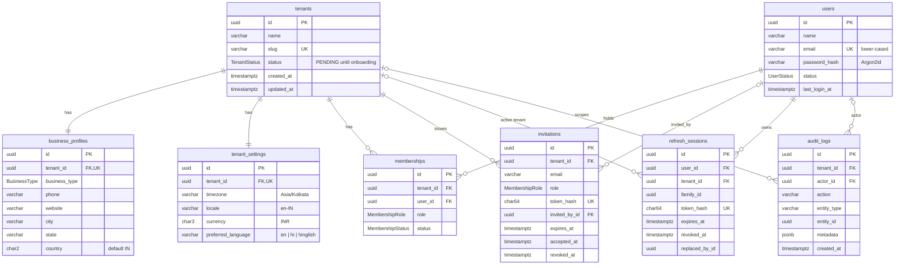

# Database design

PostgreSQL 16, managed with Prisma 7 migrations (`prisma/schema.prisma`, `prisma/migrations/`).

## Conventions

- **UUID primary keys** generated by PostgreSQL (`gen_random_uuid()`).
- **snake_case** table and column names (`@@map`/`@map`), camelCase in TypeScript.
- **`timestamptz(3)`** for all timestamps; `created_at` default `now()`, `updated_at` maintained by Prisma.
- Every tenant-owned table has **`tenant_id`** with an index.
- **`ON DELETE RESTRICT`** for every business relationship — deleting a tenant or user fails while dependent rows exist. Removing data requires an explicit deletion process (planned for a later phase). The only `SET NULL` rules are on _who did it_ pointers (`invitations.invited_by_id`, `audit_logs.actor_id`) so audit history survives a future user deletion.
- Secrets are never stored in plain text: passwords as Argon2id hashes; refresh and invitation tokens as SHA-256 hex digests.

## Entity-relationship diagram



## Tables

| Table               | Purpose                                                    | Key constraints and indexes                                                           |
| ------------------- | ---------------------------------------------------------- | ------------------------------------------------------------------------------------- |
| `tenants`           | A business on the platform; root of isolation              | `slug` unique (name-derived + random suffix)                                          |
| `business_profiles` | Business type and contact details                          | `tenant_id` unique (1:1)                                                              |
| `tenant_settings`   | Timezone, locale, currency, default AI language            | `tenant_id` unique (1:1); defaults `Asia/Kolkata`, `en-IN`, `INR`, `en`               |
| `users`             | People who sign in (global; access comes from memberships) | `email` unique                                                                        |
| `memberships`       | User × tenant with a role                                  | unique `(tenant_id, user_id)`; index `user_id`; index `(tenant_id, role)`             |
| `invitations`       | Pending/used invitations                                   | `token_hash` unique; index `(tenant_id, email)`; index `(tenant_id, created_at desc)` |
| `refresh_sessions`  | Rotating refresh-token sessions                            | `token_hash` unique; indexes `user_id`, `family_id`, `expires_at`                     |
| `audit_logs`        | Append-only trail                                          | indexes `(tenant_id, created_at desc)`, `(tenant_id, action)`, `actor_id`             |

Two columns go beyond the original specification, each for a stated reason:

- `refresh_sessions.family_id`, `replaced_by_id`, `tenant_id`, `user_agent` — needed for rotation, reuse detection and tenant context.
- `invitations.invited_by_id`, `revoked_at` — attribution and withdrawal; `tenant_settings.preferred_language` — collected on the onboarding screen.

## Enums

| Enum               | Values                                                    | Notes                                                                                 |
| ------------------ | --------------------------------------------------------- | ------------------------------------------------------------------------------------- |
| `TenantStatus`     | `ACTIVE`, `SUSPENDED`, `PENDING`                          | New tenants start `PENDING`; onboarding sets `ACTIVE`; `SUSPENDED` locks everyone out |
| `UserStatus`       | `ACTIVE`, `INVITED`, `DISABLED`                           | `DISABLED` blocks login and existing sessions                                         |
| `BusinessType`     | `BROKERAGE`, `REAL_ESTATE_AGENCY`, `BUILDER`, `DEVELOPER` |                                                                                       |
| `MembershipRole`   | `OWNER`, `ADMIN`, `MANAGER`, `SALES_AGENT`, `VIEWER`      |                                                                                       |
| `MembershipStatus` | `ACTIVE`, `INVITED`, `SUSPENDED`                          | `SUSPENDED` = "disabled" in the UI                                                    |

The same values are exported from `@rea/shared-types`; a unit test fails if they drift.

## Migrations

```bash
pnpm db:migrate        # create + apply a migration in development (prisma migrate dev)
pnpm db:deploy         # apply pending migrations (CI / production)
pnpm db:reset          # drop, re-apply and seed (development only)
pnpm db:seed           # load two demo businesses
pnpm db:test:prepare   # migrate the isolated test database
```

The initial migration is `prisma/migrations/*_init_foundation`.

## Row-Level Security rollout plan (future)

RLS is intentionally **not** enabled yet (see `architecture.md`). When it is:

1. Create a non-owner application role; keep migrations on the owner role (RLS does not apply to table owners unless `FORCE`d).
2. `ALTER TABLE … ENABLE ROW LEVEL SECURITY` on each tenant-owned table with a policy such as
   `USING (tenant_id = current_setting('app.tenant_id')::uuid)`.
3. Wrap each request's queries in an interactive transaction that first runs `SELECT set_config('app.tenant_id', $1, true)` (a Prisma client extension can do this centrally).
4. Give auth flows that legitimately cross tenants (login, membership resolution, invitation acceptance) an explicit, audited bypass role.
5. Re-run the tenant-isolation e2e suite with RLS on; add tests that issue raw unscoped queries and expect zero rows.

## Phase 2A tables: `properties` and `leads`

- Both carry `tenant_id` and every index starts with it.
- Money is `BIGINT` whole rupees (no float rounding; fits 100 crore+). `MAX_PRICE_RUPEES` caps input.
- `leads.phone` is E.164 with `UNIQUE (tenant_id, phone)` and a CHECK on the format.
- CHECK constraints: `properties_price_positive`, `properties_bedrooms_range`, `leads_budget_order`, `leads_phone_e164`.
- No hard deletes: properties are ARCHIVED; leads end as LOST/WON.
- `leads.assigned_to_id` points at `memberships` (tenant-scoped), `ON DELETE SET NULL`.

## Phase 2B tables: `conversations` and `messages`

- `conversations`: one thread with one lead on one channel (`WEB_TEST` today; `WHATSAPP`, `VOICE` later).
  `ai_enabled = false` means a human has taken over. `last_message_at` drives the inbox order.
- `messages`: `role` is BUYER, AI, AGENT (team member) or SYSTEM (e.g. "AI paused").
  AI messages store `model`, token counts and `latency_ms` (cost tracking) and a JSONB `metadata`
  with the prompt version, what was extracted, and which listings were shown and suggested — the raw
  material for the future eval pipeline.
- Both carry `tenant_id`; messages cascade-delete with their conversation; conversations never
  delete leads (`RESTRICT`).
- CHECK constraints: `messages_content_not_blank`, `messages_content_length` (≤ 8000).

## Phase 3: WhatsApp

- `whatsapp_accounts`: one per business (`tenant_id` unique). `phone_number_id` is unique across all
  businesses because Meta's webhooks are routed by it. `access_token_encrypted` is
  `v1:` + base64(iv | GCM tag | ciphertext) under `DATA_ENCRYPTION_KEY` — never stored or logged in
  plain text, never returned by the API. Disconnecting deletes the row (it only holds settings); the
  audit log keeps the history.
- `messages.external_id`: WhatsApp's `wamid`, unique per business, so Meta's webhook retries never
  create duplicates and delivery-status webhooks find their message.
- `messages.delivery_status` / `delivery_error`: for outgoing WhatsApp messages. Statuses only move
  forward (a late "delivered" never overwrites "read").
- `conversations.last_buyer_message_at`: drives WhatsApp's 24-hour reply window.
- WhatsApp conversations are one thread per buyer: a buyer writing again re-opens a closed thread.
